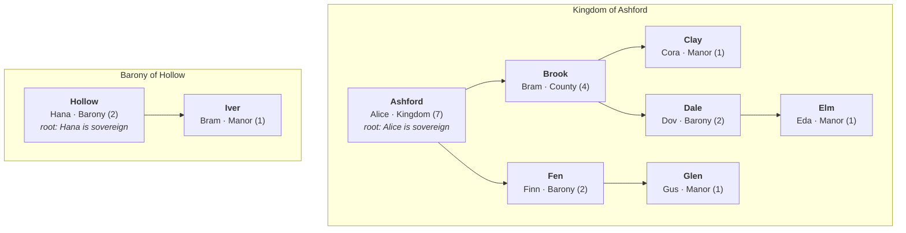

# Realms

A realm is a chain of fealty between manors, up to a sovereign with no liege above them. Each manor in a realm is held of a liege manor: it passes tribute up the chain and owes aid, and its lieges' wishes carry weight in it. Fealty binds manors rather than lords, so one lord can serve several realms through different manors. Any lord can become a sovereign, a player included, by holding a manor with no liege that other manors are held of.

[GLOSSARY.md](../../../GLOSSARY.md) defines the terms this page uses.

## Structure

The diagram shows two example realms. Each box is a manor with its lord and rank, and each arrow points from a liege manor to a vassal manor. The rank thresholds in it are illustrative: barony at 2 manors, county at 4, and kingdom at 7.

- **Lord**: the player or villager a manor is sworn to, as [Villages](villages.md#lordship) describes. Bram is the lord of Brook and of Iver.
- **Liege and vassal**: relations between two manors, not ranks. Brook is a vassal of Ashford and the liege of Clay and Dale, so Bram is Alice's vassal and the liege of Cora and Dov.
- **Sovereign**: the lord of a realm's root manor. Alice and Hana are both sovereigns.
- **Rank**: follows the number of manors in a manor's subtree. A lord's title is the highest rank among their manors, so Bram is a count.
- **Liege realm**: Bram holds manors in both realms and names Ashford as the liege realm, so Iver stands aside when Hollow clashes with Ashford.
- **Flow**: tribute and aid flow up the arrows, and wish weight flows down them.

## Fealty

- Fealty holds a vassal manor of a liege manor. A manor has at most one liege manor and any number of vassal manors. [ADR 0014](../../adr/0014-fealty-binds-manors-not-lords.md) records why fealty binds manors rather than lords.
- Only manors take part, so only lords do: players and villagers who hold a manor, on equal terms. [Village simulation](https://github.com/NoNamer777/feudum/issues/45) decides when a [villager lord](https://github.com/NoNamer777/feudum/issues/59) offers, accepts, or breaks fealty.
- No manor can be its own liege, directly or up the chain. Lords can stand in any mix of liege and vassal across their manors. A lord can be a sovereign in one realm and a vassal in another, or the vassal of a lord who is their own vassal through another manor.
- A manor can be held of another manor in the same village.
- Fealty forms when the lords of both manors agree. The village of the vassal manor can refuse a player liege whose standing with it is below neutral.
- Either lord can break the bond at any time. A player who breaks it as the lord of the vassal manor loses standing with the village of the liege manor. A liege who releases a vassal manor loses nothing.
- The bond stays with the manors when either changes hands, such as through a [contest](https://github.com/NoNamer777/feudum/issues/38). The new lord can break it like any other.
- [Oath of fealty](https://github.com/NoNamer777/feudum/issues/101) designs how fealty is offered, sworn, and broken in play.

## Realm record

- A realm is a persistent record of the tree of manors under its root manor. Its sovereign is the lord of the root manor. [Sovereignty](https://github.com/NoNamer777/feudum/issues/100) designs how a sovereign claims the realm, is crowned, and is recognized by other realms.
- A realm begins when a manor with no liege accepts its first vassal manor. A lone manor with no liege and no vassals is not a realm.
- A realm ends when its root manor has no vassal manors left.
- A realm keeps its record when its root manor changes hands, and the new lord becomes its sovereign.
- A realm's name is drawn from data-driven name pools, often built on the name of the root manor's village, as in "Kingdom of Ashford". The sovereign can rename it at will, since a realm is a bond between lords rather than a community.
- A realm has no territory of its own. It reaches as far as its manors, so a village whose manors serve different realms sits partly in each.

## Manors ending and merging

- A manor ends when its lord renounces, falls below the lordship threshold, or lapses, or when it holds no buildings or villagers, as [Villages](villages.md#manors) describes. Its bond to its own liege manor ends with it.
- When a manor below the root ends, its vassal manors pass up and are held directly of its liege manor, so the realm stays whole.
- When a root manor ends, its realm ends, and each of its vassal manors goes free. Each freed manor with vassals of its own begins a new realm.
- When a lord's second manor in a village merges into the first, the merged manor keeps the liege of the manor it merged into, and the other manor's bond to its liege ends. The merged manor keeps the vassal manors of both. A bond that would make the merged manor its own liege, directly or up the chain, ends.

## Tribute and aid

- A manor passes a share of everything it takes in up to its liege manor, including the tribute from its own vassals, so tribute cascades to the sovereign. [Village economy](https://github.com/NoNamer777/feudum/issues/44) sets the share.
- A manor owes aid to its liege manor, and the liege owes it protection. [Village defense](https://github.com/NoNamer777/feudum/issues/90) designs how aid plays out and when realms clash.
- Tribute and aid are owed per manor, so a lord's manors in different realms each serve their own liege.

## Wish weight

- Every liege up the chain carries weight for their wishes in a vassal manor, less with each step up. The manor's own lord always outweighs any liege.
- Liege weight applies only inside the vassal manor. Elsewhere in the village, a liege's wishes carry the weight of their standing, as [Villages](villages.md#standing-and-wishes) describes.
- While a village's standing for a player liege is below neutral, that liege's wishes carry no liege weight in its manors, only the weight of their standing. Tribute and aid still flow.
- [Realm laws](https://github.com/NoNamer777/feudum/issues/102) designs rules a sovereign sets across the whole realm.

## Peace in the realm

- A player can't contest a manor above or below one of their own manors in a realm. That is felony.
- A contest against any other manor in a realm where the player holds a manor needs leave from the lord of the nearest manor that holds both the target and one of the player's manors in its subtree. A villager lord grants or refuses leave under Village simulation.
- Contests across realms need no leave. [Lordship contests](https://github.com/NoNamer777/feudum/issues/38) designs how a contest starts and is won.

## Liege realm

- A lord with manors in two or more realms names one of them as their liege realm.
- Until the lord names one, their liege realm is the realm of their highest-ranked manor, so a sovereign's is their own realm.
- None of the lord's manors owes aid against their liege realm. When a clash would set one of their manors against it, that manor stands aside.
- A liege realm affects aid only, never tribute or wish weight.
- A lord can name another liege realm at any time, except while a clash between the realms involved is underway.

## Rank

- A manor's rank follows the number of manors in its subtree, itself included. Only a root manor can reach the top rank.
- A lord's title is the highest rank among their manors. Rank is a title only and grants no rights of its own.
- Ranks, their thresholds, and their titles are data-driven. Title pools can supply variants, such as baroness or countess. The defaults:

| Rank    | Manors | Title |
|:--------|-------:|:------|
| Manor   |      1 | Lord  |
| Barony  |      3 | Baron |
| County  |      8 | Count |
| Duchy   |     20 | Duke  |
| Kingdom |     40 | King  |

- [Heraldry](https://github.com/NoNamer777/feudum/issues/103) designs arms and banners for manors and realms, and how they show rank.

## Boundaries

Realms owns fealty, the realm record, peace in the realm, liege realms, and rank. Other mechanics own the rest, each linked to its page or, while it waits for a design, its issue:

- **[Villages](villages.md)**: manors, lordship, and standing.
- **[Village economy](https://github.com/NoNamer777/feudum/issues/44)**: tithes, and the share of them a manor passes up as tribute.
- **[Village defense](https://github.com/NoNamer777/feudum/issues/90)**: aid, protection, and clashes between realms.
- **[Village simulation](https://github.com/NoNamer777/feudum/issues/45)**: how villager lords offer, accept, and break fealty, and grant leave.
- **[Lordship contests](https://github.com/NoNamer777/feudum/issues/38)**: how a contest starts and is won.
- **[Oath of fealty](https://github.com/NoNamer777/feudum/issues/101)**: how fealty is offered, sworn, and broken in play, and how leave is asked.
- **[Sovereignty](https://github.com/NoNamer777/feudum/issues/100)**: claiming a realm, coronation, and recognition by other realms.
- **[Realm laws](https://github.com/NoNamer777/feudum/issues/102)**: rules a sovereign sets across a realm.
- **[Heraldry](https://github.com/NoNamer777/feudum/issues/103)**: arms and banners for manors and realms.
- **[Realm maps](https://github.com/NoNamer777/feudum/issues/99)**: showing realms on [Cartography](https://github.com/NoNamer777/feudum/issues/98) maps.
